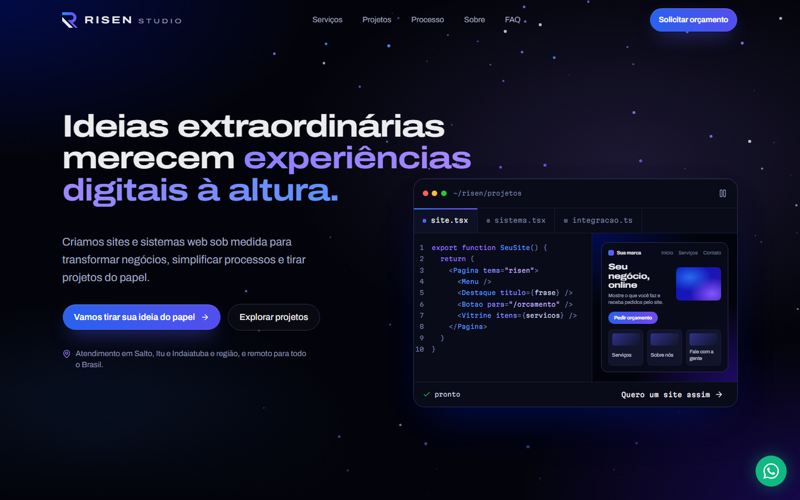
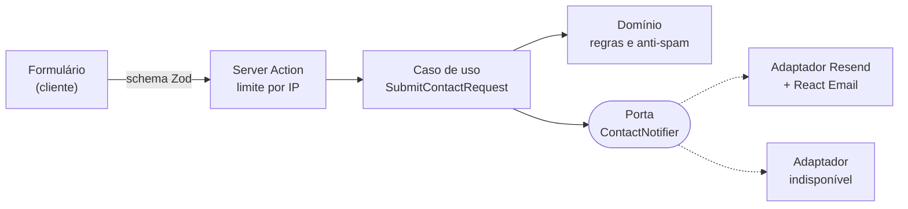

<div align="center">

# Risen Studio

**Site comercial de um estúdio de desenvolvimento web, do design ao deploy.**

[](https://github.com/juliocesarEL/Risen_StudioV2/actions/workflows/ci.yml)
[](https://github.com/juliocesarEL/Risen_StudioV2/actions/workflows/seguranca.yml)


**[risenstudio.com.br](https://risenstudio.com.br)**

</div>

<p align="center">
  
  &nbsp;
  
</p>

## Sobre o projeto

A Risen Studio é o meu estúdio de desenvolvimento em Salto, SP. Este é o site
comercial dele, que eu desenhei e desenvolvi sozinho, da identidade visual ao
deploy. O objetivo é um só: **transformar visitantes em pedidos de orçamento**,
pelo formulário ou pelo WhatsApp.

O próprio site é a primeira demonstração do trabalho: ele precisava ser rápido
no celular, acessível, bem ranqueado e com acabamento de produto, sem cair na
cara de template.

## Destaques

- **Bancada ao vivo no hero.** Um editor digita o código de um site, um sistema
  ou uma integração enquanto a prévia se monta ao lado. É tudo CSS, com os tempos
  calculados em TypeScript: a animação começa na primeira pintura, sem esperar o
  JavaScript, e respeita a preferência por movimento reduzido.
- **Formulário de orçamento que não perde ninguém.** O HTML chega pronto do
  servidor e o JavaScript (React Hook Form, Zod, Radix) só é baixado quando o
  formulário se aproxima da tela. Se a pessoa digitar ou enviar antes disso,
  nada se perde: o texto é aproveitado e o envio é repetido quando o formulário
  fica pronto.
- **Envio seguro e honesto.** Server Action com o mesmo schema Zod do navegador,
  limite de envios por IP, campo isca contra robôs e chave do provedor de e-mail
  restrita ao servidor (`server-only`). Sem provedor configurado, o site mostra
  um erro claro e oferece o WhatsApp: nunca simula um sucesso.
- **Clean Architecture onde há regra de negócio.** O fluxo de contato é separado
  em domínio, aplicação e infraestrutura, e o ESLint impede que as camadas
  internas importem Next.js, React ou o SDK do Resend (veja
  [Arquitetura](#arquitetura)).
- **Cena WebGL só quando vale a pena.** O fundo de partículas carrega depois que
  a página fica ociosa, num pacote separado, e só em aparelhos com GPU. A
  checagem roda num Web Worker, sem travar a página.
- **Página estável enquanto carrega.** Os títulos usam uma fonte larga; fontes
  reservas com a mesma largura evitam que o texto "pule" quando ela chega
  (Cumulative Layout Shift praticamente zero).
- **SEO, GEO e AEO.** Metadata por página, imagens de compartilhamento geradas
  no build, sitemap, robots e dados estruturados (`ProfessionalService` com os
  serviços, `Person` para o fundador, `WebSite`, `FAQPage`, `CreativeWork` e
  `BreadcrumbList`). Para assistentes de IA, um [`/llms.txt`](https://risenstudio.com.br/llms.txt)
  gerado a partir do mesmo conteúdo do site.
- **Acessibilidade testada.** WCAG 2.2 AA verificado com axe em todas as
  páginas, navegação completa por teclado, foco visível e alvos de toque de 44 px.
- **Conteúdo separado do código.** Nenhum texto fica dentro dos componentes:
  todo o conteúdo é tipado em TypeScript e MDX, em `src/content`.

**PageSpeed Insights (celular):** Acessibilidade 100, Práticas recomendadas 100
e SEO 100.

## Stack

| Área           | Tecnologias                                                                  |
| -------------- | ---------------------------------------------------------------------------- |
| Framework      | Next.js 16 (App Router, Server Components, Server Actions, Cache Components) |
| Linguagem      | TypeScript (modo estrito)                                                    |
| Interface      | React 19, Tailwind CSS 4, shadcn/ui (Radix), React Bits, Motion              |
| Formulário     | React Hook Form, Zod                                                         |
| E-mail         | Resend, React Email                                                          |
| Conteúdo       | TypeScript tipado e MDX                                                      |
| Testes         | Vitest, Playwright, axe-core                                                 |
| Qualidade      | ESLint (com regras de fronteira da arquitetura), Prettier                    |
| Infraestrutura | Vercel (hospedagem, DNS, Analytics, Speed Insights), GitHub Actions          |

## Arquitetura

```text
src/
├── app/               rotas (App Router), metadata, imagens OG, sitemap, Server Action
├── components/
│   ├── layout/        navegação, menu do celular, rodapé
│   ├── sections/      seções da página inicial
│   ├── case-study/    página de projeto
│   ├── shared/        logo, CTAs, entradas animadas...
│   ├── reactbits/     componentes React Bits (vendor/ = código original)
│   └── ui/            shadcn/ui
├── content/           todo o conteúdo do site (TS + MDX)
├── core/contact/      envio de orçamento, em Clean Architecture
│   ├── domain/        regras: a solicitação de contato e a política anti-spam
│   ├── application/   caso de uso SubmitContactRequest e a porta ContactNotifier
│   └── infrastructure/ adaptadores: Resend + React Email, e o "indisponível"
├── lib/               utilitários puros e testados (WhatsApp, telefone, SEO...)
└── styles/            fontes e espelho das cores da marca
```

O envio de um orçamento atravessa as camadas assim:



O caso de uso só conhece a porta `ContactNotifier`. Trocar o Resend por outro
provedor, um CRM ou um webhook é escrever um novo adaptador, sem tocar nas
regras. Essas fronteiras não dependem de disciplina: o ESLint falha se o domínio
ou a aplicação importarem Next.js, React, Resend, Zod ou componentes.

O resto do site é interface e conteúdo, sem regra de negócio. Ali a separação é
outra: componentes de apresentação, conteúdo tipado em `src/content` e lógica
pura em `src/lib`, coberta por testes.

## Qualidade

| Verificação      | Ferramenta          | O que cobre                                                                                                                              |
| ---------------- | ------------------- | ---------------------------------------------------------------------------------------------------------------------------------------- |
| Tipos            | TypeScript          | Projeto inteiro em modo estrito, incluindo as rotas tipadas do Next.js.                                                                  |
| Lint             | ESLint              | Regras do Next.js e do React, ordem de imports e fronteiras da arquitetura.                                                              |
| Testes unitários | Vitest (122 testes) | Caso de uso com notificador falso, schema do formulário, utilitários, regras da seção de projetos, e-mail e integridade do conteúdo.     |
| Ponta a ponta    | Playwright          | Fluxo de orçamento, validação acessível, máscara de telefone, menu do celular e ausência de rolagem horizontal, no desktop e no celular. |
| Acessibilidade   | axe-core            | WCAG 2.0 a 2.2, níveis A e AA, em todas as páginas; hierarquia de títulos; link "Pular para o conteúdo".                                 |

Os testes ponta a ponta fazem o build de produção e forçam a chave de e-mail
vazia: nunca enviam mensagens reais.

## CI/CD

- **Integração contínua (GitHub Actions):** a cada push e pull request, o
  [workflow](.github/workflows/ci.yml) roda tipos, lint, formatação e testes
  unitários em paralelo com o build de produção e os testes ponta a ponta. Se
  algo falhar, o relatório do Playwright fica disponível para download.
- **Entrega contínua (Vercel):** cada push na `main` vai para produção, e cada
  pull request ganha um link de pré-visualização.
- **Dependências:** o Dependabot abre, uma vez por mês, um pull request com as
  atualizações agrupadas, que passa pelo CI antes de qualquer merge.
- **Segurança:** o [`pnpm audit`](.github/workflows/seguranca.yml) roda em cada
  push e pull request e toda semana, mesmo sem mudanças no código, e falha se
  alguma dependência tiver uma vulnerabilidade alta ou crítica.

## Rodando localmente

Requisitos: Node.js 22 ou mais recente e pnpm (`corepack enable` instala a
versão certa).

```bash
pnpm install
cp .env.example .env.local   # opcional: sem chaves, o formulário mostra "indisponível"
pnpm dev                     # http://localhost:3000
```

| Comando            | O que faz                                              |
| ------------------ | ------------------------------------------------------ |
| `pnpm dev`         | Servidor de desenvolvimento.                           |
| `pnpm build`       | Build de produção.                                     |
| `pnpm check`       | Tipos, lint, formatação e testes unitários.            |
| `pnpm test:e2e`    | Testes ponta a ponta e de acessibilidade (porta 3100). |
| `pnpm screenshots` | Capturas de 320 a 1920 px; acusa rolagem horizontal.   |

Como editar o conteúdo, adicionar projetos e publicar: veja o
[guia de manutenção](docs/guia-de-manutencao.md).

## Autor

**Julio César Lavras**, desenvolvedor full stack, formado em Ciência da
Computação, fundador da Risen Studio.

[LinkedIn](https://www.linkedin.com/in/juliocesarel/) ·
[GitHub](https://github.com/juliocesarEL) ·
[Instagram](https://www.instagram.com/risenstudio.dev/) ·
[risenstudio.com.br](https://risenstudio.com.br)

## Licença

O código está aberto para consulta e estudo. Todos os direitos reservados: o
código, a marca Risen Studio, os textos, o logotipo e as imagens de projetos
(inclusive as de clientes) não podem ser reutilizados sem autorização.
Bibliotecas, componentes do React Bits e fontes mantêm as próprias licenças.
Detalhes em [LICENSE](LICENSE).
